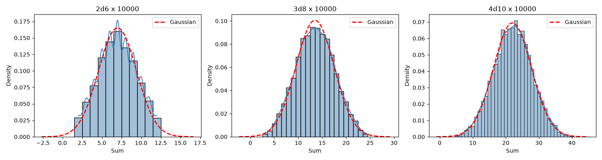

# dice

A dice simulation toolkit — roll dice, compute statistics, and visualize distributions with histogram plots and Gaussian overlays.



## Installation

```bash
pip install -e .
```

## Usage

### Run a simulation

```bash
dice simulate -d 2 -f 6 -r 10000
```

Options:
- `-d` / `--num-dice` — number of dice (default: 1)
- `-f` / `--faces` — faces per die (default: 6)
- `-r` / `--rolls` — number of rolls (default: 10000)
- `-s` / `--seed` — random seed for reproducibility
- `--format` — output format: `json` (default) or `text`

### Generate histogram plots

```bash
dice plot 2d6 3d8x5000
```

Specs use `NdF` or `NdFxR` notation (e.g. `2d6` for two six-sided dice, `3d8x5000` for three eight-sided dice with 5000 rolls).

Options:
- `-r` / `--rolls` — default rolls per experiment (default: 10000)
- `-s` / `--seed` — random seed
- `-o` / `--save` — save figure to file instead of showing

## Library usage

```python
from dice import experiment, theoretical_stats, run_experiments
from dice.config import ExperimentConfig

# Run a simulation
values = experiment(n=6, dices=2, rolls=10000)

# Get theoretical statistics
mu, sigma = theoretical_stats(num_dice=2, faces=6)

# Plot experiments
configs = [ExperimentConfig(num_dice=2, faces=6, num_rolls=10000)]
run_experiments(configs)
```

## License

MIT
